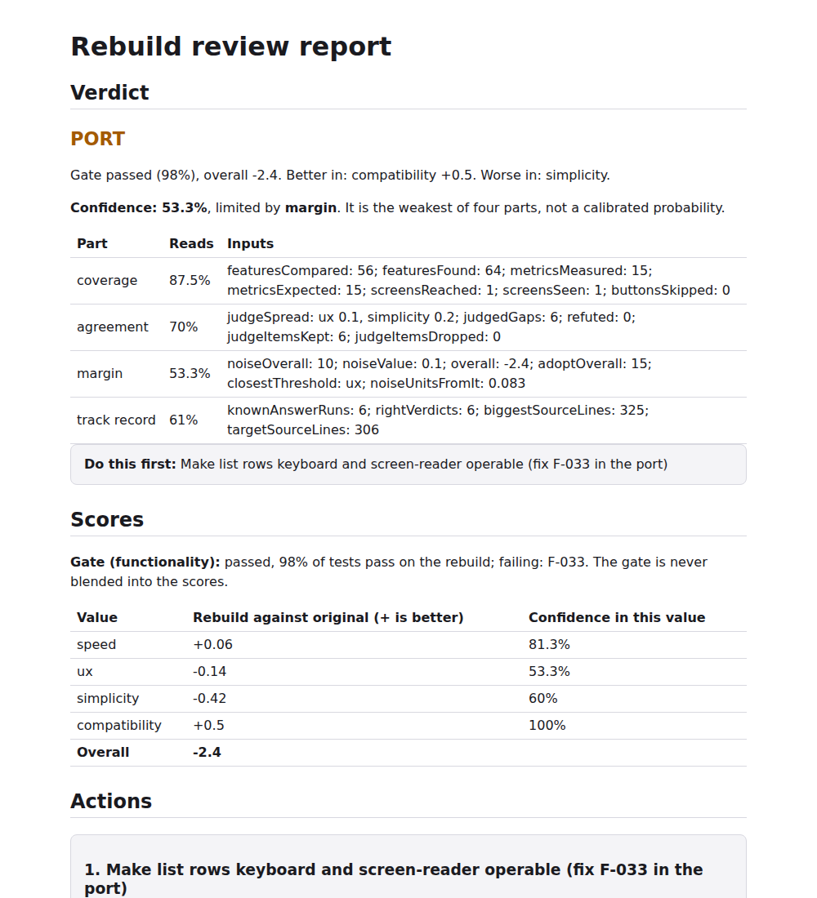

# rebuild-review

Rebuild your project from what it does and how it looks, then see if the rebuild beats the original.



Built with [Playwright](https://playwright.dev), [axe-core](https://github.com/dequelabs/axe-core) and [Electron](https://www.electronjs.org).

A one-shot, expensive review for a project that has grown by piling on features.
It does not read a diff. It takes the project apart into what it does and what it
looks like, rebuilds the full project the best and simplest way, and scores the two.

Works on any kind of project: web, Android, iOS, Flutter, desktop, CLI, library, backend. Web, Electron, CLI, backend and Node library are driven today.
The pipeline is the same, and only capture and the test driver change per platform.

Platforms with a capture adapter: web (`adapters/web`), Electron (`adapters/electron`), command-line tools (`adapters/cli`) and HTTP services with no pages (`adapters/backend`). Setup for each is in AGENTS.md.

## Install and run

```
claude plugin marketplace add MehdiMamas/rebuild-review
claude plugin install rebuild-review@rebuild-review
```

Then, in Claude Code: `/rebuild-review:rebuild-review <target-path> maxUsd=<dollars>`.

It only runs when you call it. The target is never changed: each run writes to its own folder,
`<target>-rebuild-review/<run-id>/`, next to the target. A web target needs Chromium
(`npx playwright install chromium`); adapter packages install themselves on the first run.

### Run unattended

On a machine with no one at the keyboard (a build server, over ssh), use the launcher in the
plugin folder instead of `claude -p` directly:

```
scripts/unattended.sh <target-path> --max-usd <dollars> [--base url@ref|none|keep] [--run-dir <run folder>] [-- <extra claude flags>]
```

It never asks a question (the detected base is kept unless `--base` says otherwise), refuses to
start without a spending limit, and sets `CLAUDE_CODE_PRINT_BG_WAIT_CEILING_MS=0`: without it,
`claude -p` stops the review 10 minutes after its last turn. `--run-dir` resumes an earlier run;
finished phases are skipped. On Linux with no display, put `xvfb-run -a` in front.

## What goes in

- **Words:** every feature, written as behaviour someone can check.
- **The rendered app:** what it renders on its platform, plus screenshots, network traffic
  and timings. HTML and CSS on the web, the view tree on Android, iOS and Flutter, stdout
  and files for a CLI. Never the source.
- **The technology used,** unless the review decides it should change.

## What comes out

**The full project, done the right, best way:** complete, backend included, in its own
git repo, with the same look and behaviour, built without seeing the original source.

With it come:

- **Parity:** one test suite run against both. A rebuild that lost a feature gets no score.
- **Score:** how it was done, how it's done now, what should be done, judged on
  simplicity, compatibility, speed and performance, and UX.
- **Confidence:** a percentage beside the verdict, computed by code, naming the part that limits
  it. It is the weakest of four parts: coverage (what was tested and measured out of what was
  found), agreement (do the judges agree, are their scores kept), margin (how far the result sits
  from the verdict's thresholds) and track record (how often the tool was right on known answers,
  `benchmark/calibration.json`). It is not yet a proven probability: it is only as good as the
  known-answer runs behind it, and the page says what they covered.

## Cost and size

A run always covers the whole app. Before spending, the skill measures the source (`scripts/size.mjs`) and prints an estimated cost range; the run needs `maxUsd` at or above the high end, otherwise nothing is spent. Budgets scale with size (`scale.json`), and actual spend per phase is written to `cost.json` in the run folder. `cost.json` covers the stack and rebuild steps only.

**`maxUsd` only limits those steps too.** The agents that inventory, write tests and judge are not priced or capped, so the true total is higher than `cost.json` and can pass `maxUsd`.

Measured so far:

| Project | Source lines | `cost.json` | Rest of the run |
|---|---|---|---|
| The planted fixture in `benchmark/` | 306 | $11.65 to $15.19 | not priced |
| A private web app, several runs | 3,159 to 6,270 | $6 to $11 | one run: 63 agents, 3.15M tokens, 73 minutes |
| actualbudget/actual (11 areas) | 351,633 | $185.64 | not priced |

### Rerun from a phase

To redo the last phases of a finished run (for example after the scoring or the tests changed) without building again:

```
node scripts/rerun.mjs <run folder> --from Parity|Score|Report [--no-build]
```

then start the review again with that `runDir`. The named phase and every later one are redone; earlier phases, `project/`, `rebuild/`, `golden/`, `parity/tests/` (so no test is rewritten), `events.jsonl`, `cost.json` (it keeps adding) and `size.json` stay. The old results move to `<run folder>/previous-1/` (the next rerun uses `previous-2/`, and so on): `parity/` results, `golden-rebuild/`, `score/` and `report/` for `--from Parity`; `score/` and `report/` for `--from Score`; `report/` for `--from Report`. `--from Score` and `--from Report` use the earlier rebuild capture. `parity/tests/` is kept as it is, so data a test left behind is still there. It refuses (exit 2, nothing changed) when the run is not finished up to the rebuild or a command of the run is still going. With `--no-build` it writes `NoBuild.done`: the estimate is skipped (no `maxUsd` needed) and the parity loop stops with "not rebuilt" instead of building; failures stay in `parity.json`. A plain resume of that folder keeps `NoBuild.done` (run `rerun.mjs` without `--no-build` to clear it). A rerun needs `inventory/states.json` and `golden/manifest.json`. With `scripts/unattended.sh`, use `--run-dir <dir> --from <Phase> [--no-build]`.

### Big apps

A big app is split into areas inside the run; the run still covers the whole app. Each area is inventoried, tested, rebuilt and judged on its own, and the scores are weighed by lines of code. The report has a Coverage section: features found, tested and rebuilt per area, screens reached, what was not reached and what was excluded (with the reason).

## Watch a run

`node scripts/watch.mjs <run folder>` serves a live page for a run on 127.0.0.1 and prints its link (the link holds a random token; every route needs it). It shows the phases, the decisions made so far, what is running now, what has been made (features, tests, screens) and the verdict. It reads the run folder only. With `scripts/unattended.sh --run-dir <dir> --watch [port]` it starts by itself and prints the link and an `ssh -L` line for opening it from another machine. The server ends 30 minutes after the run finishes or stops.

## Reading the report

The run ends with one page, `report/index.html`, with no scripts and its images embedded.

- **Verdict**, decided by code from `rubric.json`: `adopt` (the rebuild passed the feature gate and is better overall, with no value clearly worse), `port` (not adopt, but some value is better, so take those parts), `leave` (keep the original), or `none`, shown as "no verdict", given when no parity test ran on the rebuild, so nothing shows it works.
- **Gate:** the share of features whose tests pass on the rebuild. It sits beside the scores and is never blended into them.
- **Scores:** -100 to +100 overall, positive means the rebuild is better. Each value is half measured numbers, half blind judges. A metric missing on either side reads "not measured", never 0.
- **Actions:** what to do next. An action whose citation is false is dropped.
- **Coverage:** what was reached, and what was not.
- **Confidence:** a low number with "track record" as the limit means the tool has few checked runs, not that this verdict looks bad.

## Example report

[`docs/example-report.html`](docs/example-report.html) is the report from one run on the planted fixture; download it and open it in a browser. Its link to the project does not work outside the run folder.

## Known limits

- A dead route stays. A page reachable only by typing its address looks the same as a hidden feature that must survive, so the rebuild keeps it. On the planted fixture, rebuilds beat 14 of 15 items, and this is the miss ([#9](https://github.com/MehdiMamas/rebuild-review/issues/9)).
- Capture exists for web, Electron, command-line tools and HTTP services only. A service whose data lives in a database server outside the machine is refused with the reason. Other platforms stop with a plain reason.
- Compatibility is narrow: accessibility violations and horizontal overflow at 390 px, in Chromium. Other browsers are not checked.
- Screens are found by crawling and clicking, up to a cap (`--max-screens`, 30 by default). Screens cut by the cap are listed in Coverage, not hidden.
- The app runs with stand-in settings (`env` in `run.json`), never real secrets, so anything behind a real external service is only as good as its stand-in.
- Big apps: one real run (actualbudget/actual, 351,633 lines) finished every phase, but only 418 of 962 features got a test (most need state the demo data cannot make, such as linked bank accounts) and 49% passed on the rebuild. Details in issue #35.
- Confidence is not a calibrated probability.

## License

MIT, see [LICENSE](LICENSE).
